# Customer Relationship Management

A customer relationship management system for tracking leads, contacts, companies, deals, notes, tasks, and sales activity.

## Overview

Django CRM gives a signed-in user a private workspace for moving potential sales through a lead and deal workflow. It records business context such as company details, contact history, deal stages, notes, and follow-up tasks in one application.

The project includes Django’s built-in authentication, an owner-scoped CRUD interface, a sortable Kanban board, and a contact 360-degree timeline assembled from related CRM activity. It uses SQLite and runs locally as a standard Django project.

## Screenshots

### Dashboard

| Overview and KPIs | Activity, tasks and deals by stage |
|---|---|
| [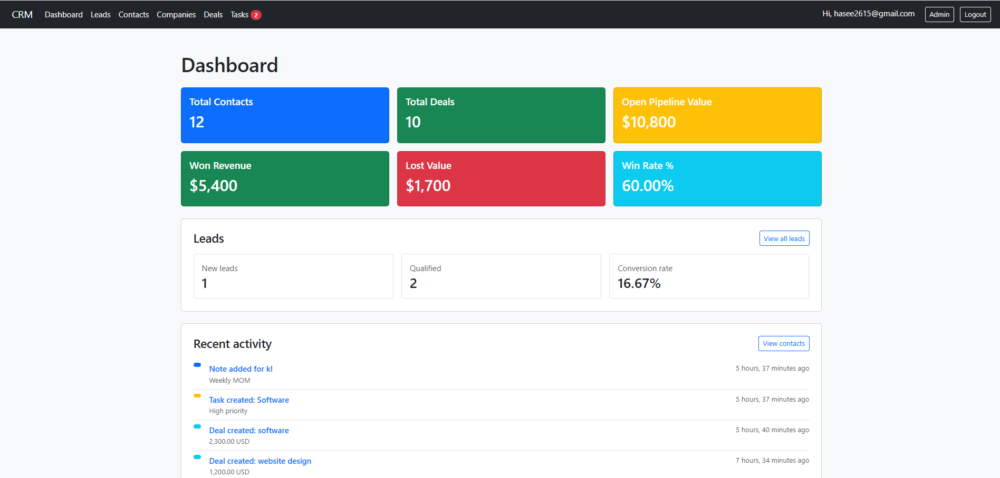](docs/screenshots/dashboard1.png.png) | [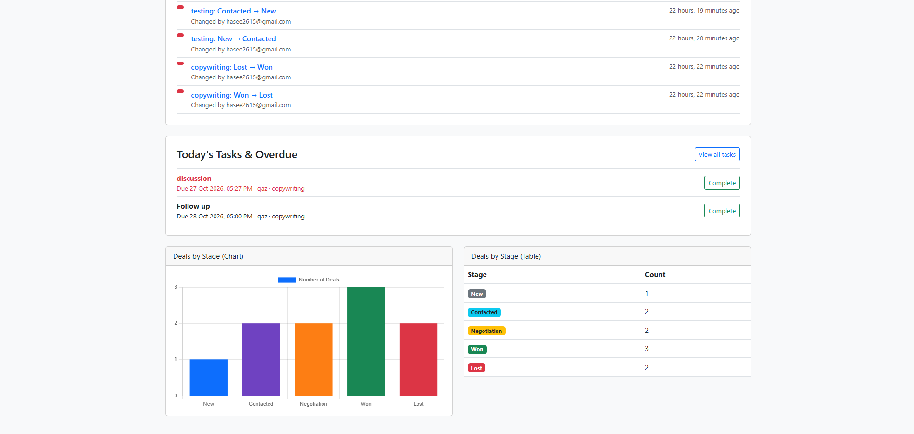](docs/screenshots/dashboard2.png.png) |

### Leads

| Lead list with summary cards | Lead detail and conversion |
|---|---|
| [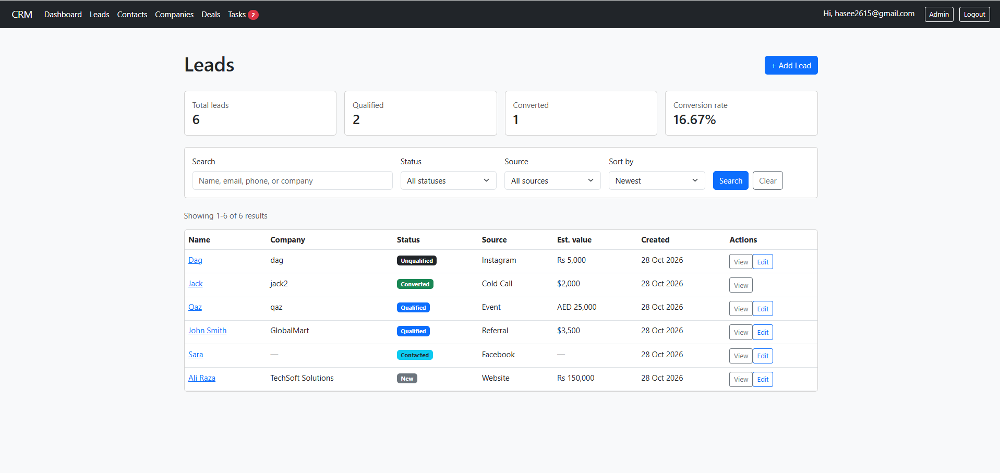](docs/screenshots/leads1.png.png) | [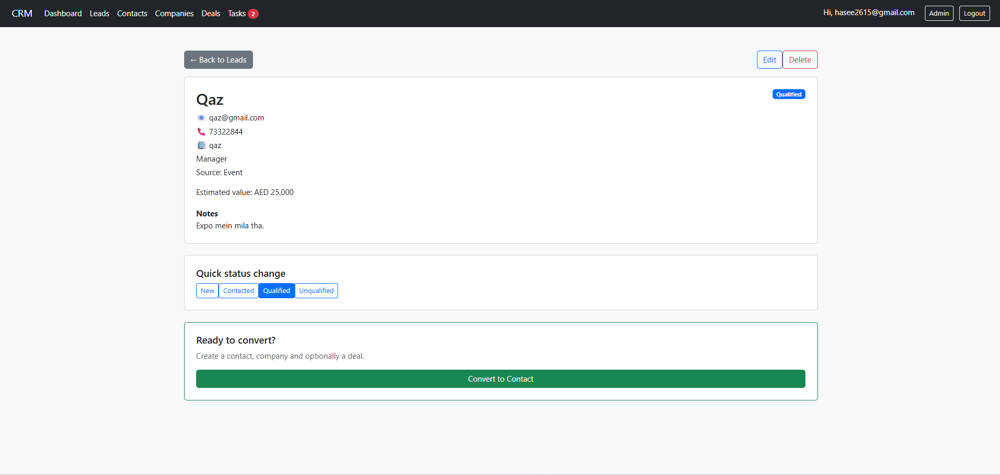](docs/screenshots/leads2.png.png) |

### Contacts and companies

| Contacts list | Contact detail |
|---|---|
| [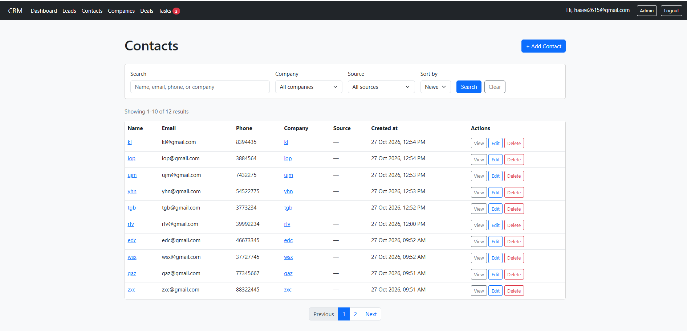](docs/screenshots/contacts1.png.png) | [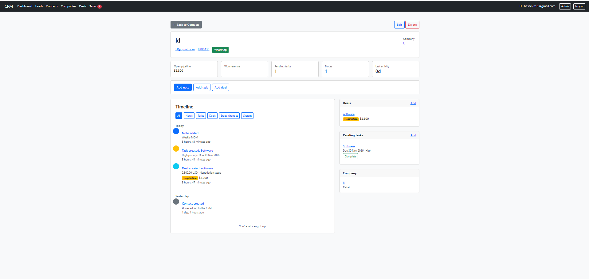](docs/screenshots/contacts2.pngg.png) |

| Companies list | Company detail |
|---|---|
| [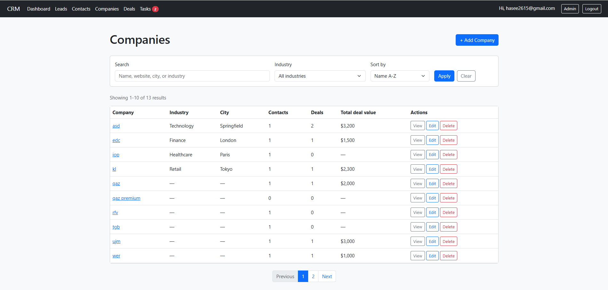](docs/screenshots/companies1.png.png) | [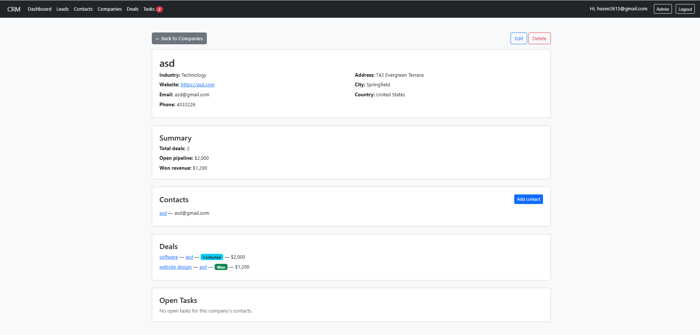](docs/screenshots/companies2.png.png) |

### Deals

| Kanban board | Deals list |
|---|---|
| [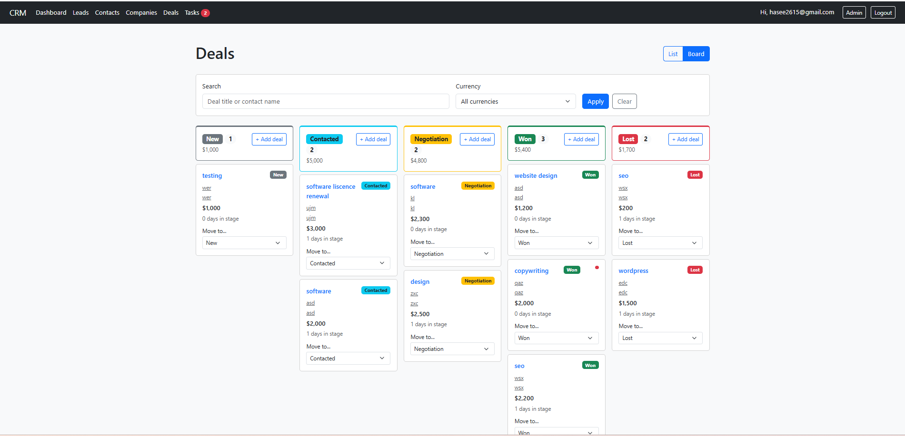](docs/screenshots/dealsboard.png.png) | [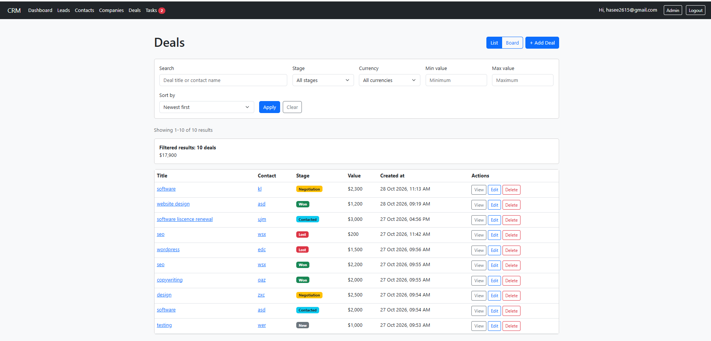](docs/screenshots/dealslist.png.png) |

### Tasks and authentication

| Tasks | Sign in | Sign up |
|---|---|---|
| [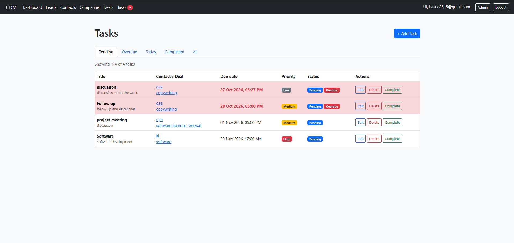](docs/screenshots/tasks.png.png) | [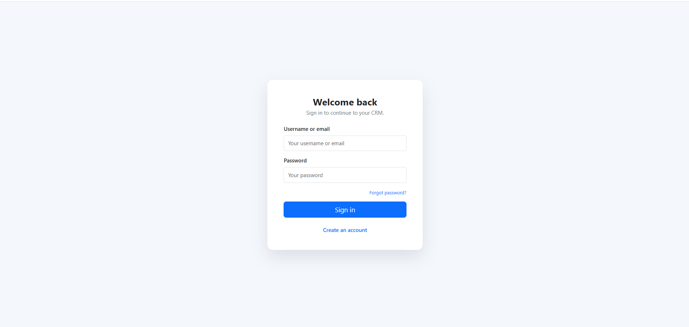](docs/screenshots/signin.png.png) | [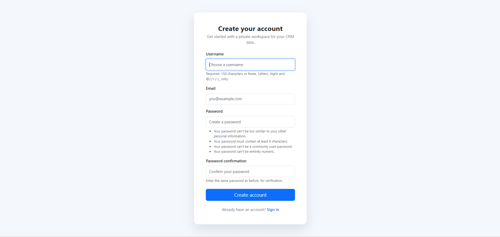](docs/screenshots/signup.png.png) |

## Features

### Authentication

Sign up, sign in by username or email, log out, reset passwords, and access the CRM and mutation endpoints securely through login protection.

### Leads and conversion

Create, manage, search, filter, sort, and paginate leads; track status and deal value; and convert leads into contacts, companies, deals, or notes while avoiding duplicate records.

### Contacts

Create and manage contacts with validated details, search and filter their lists, quickly add companies, and view related deals and activity timelines.

### Companies

Create and manage company profiles, prevent duplicate names, quickly add companies from contact forms, and view related contacts and grouped deal totals.

### Deals

Create and manage deals in PKR, USD, AED, GBP, or EUR, track stage changes and history, validate ownership, and organize deals through searchable and filterable views.

### Kanban board

Move deals across New, Contacted, Negotiation, Won, and Lost columns with SortableJS, filter by currency or deal, view overdue tasks and grouped totals, and add deals quickly.

### Notes and tasks

Attach and manage notes and tasks, track priorities and due dates, filter task status, mark tasks complete, and link both to contacts or deals.

### Contact 360 timeline

Combine contact, lead, note, task, deal, and stage history into a searchable, paginated timeline with category filters and currency summaries.

### Dashboard and KPIs

Display owner-scoped contact and deal totals, pipeline values, closed revenue, win rate, lead metrics, recent activity, overdue tasks, and a deals-by-stage chart.

### Search, pagination, and theme

Use URL-preserved search and filters, safe pagination, responsive Bootstrap layouts, and a shared CRM stylesheet across server-rendered pages.

### Admin panel

Manage leads, contacts, companies, deals, notes, tasks, and stage history from `/admin/`, including the same ownership and stage-change behavior used by the application.

## Tech Stack

| Area | Technology |
|---|---|
| Backend | Python 3.14.2 |
| Web framework | Django 6.0.1 |
| Dependency | python-dotenv 1.0+ |
| Database | SQLite 3 |
| Frontend | Django templates |
| CSS/UI | Bootstrap 5.3.0 |
| Charts | Chart.js |
| Drag and drop | SortableJS 1.15.6 |
| Static assets | Django staticfiles |
| Email | Django SMTP email backend |

## Architecture


```text
crm/
├── admin.py                 # Django Admin registrations
├── apps.py                  # CRM app configuration
├── context_processors.py    # Task badge counts
├── forms.py                 # CRUD and authentication forms
├── migrations/              # Database schema migrations
├── models.py                # CRM domain models
├── services.py              # Conversion, timeline, KPI, and board logic
├── static/css/brand.css     # Shared styling
├── templates/crm/           # User-facing and authentication templates
├── templatetags/            # Currency and stage template helpers
├── tests.py                 # Integration and model/service tests
└── views.py                 # CRUD views and JSON endpoints

crmproject/
├── settings.py              # Django configuration
├── urls.py                  # URL routing
├── asgi.py                  # ASGI entry point
└── wsgi.py                  # WSGI entry point

manage.py                    # Django management commands
requirements.txt             # Python dependencies
.env                         # Local secret configuration (not committed)
.env.example                 # Safe environment-variable template
```

### Entity relationships

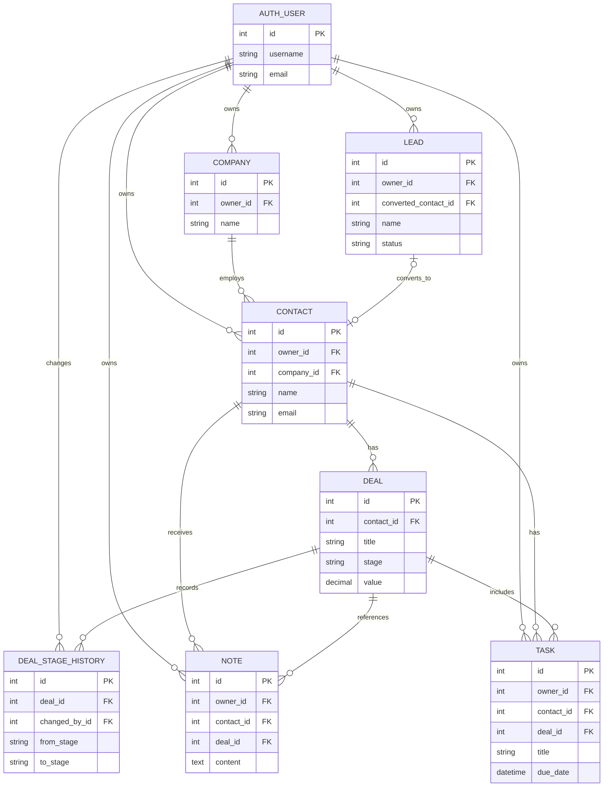

### Installation

#### Windows (PowerShell)

```powershell
git clone <repository-url>
cd crm
py -m venv venv
.\venv\Scripts\Activate.ps1
python -m pip install -r requirements.txt
copy .env.example .env
python manage.py migrate
python manage.py createsuperuser
python manage.py runserver
```

If PowerShell script activation is disabled, activate with:

```powershell
.\venv\Scripts\python.exe -m pip install -r requirements.txt
.\venv\Scripts\python.exe manage.py migrate
.\venv\Scripts\python.exe manage.py createsuperuser
.\venv\Scripts\python.exe manage.py runserver
```


### Demo data

No fixture or seed management command is included in this repository, so demo data is not automatically available.

The application separates records by authenticated owner, so the workflow above operates on that account’s data only.